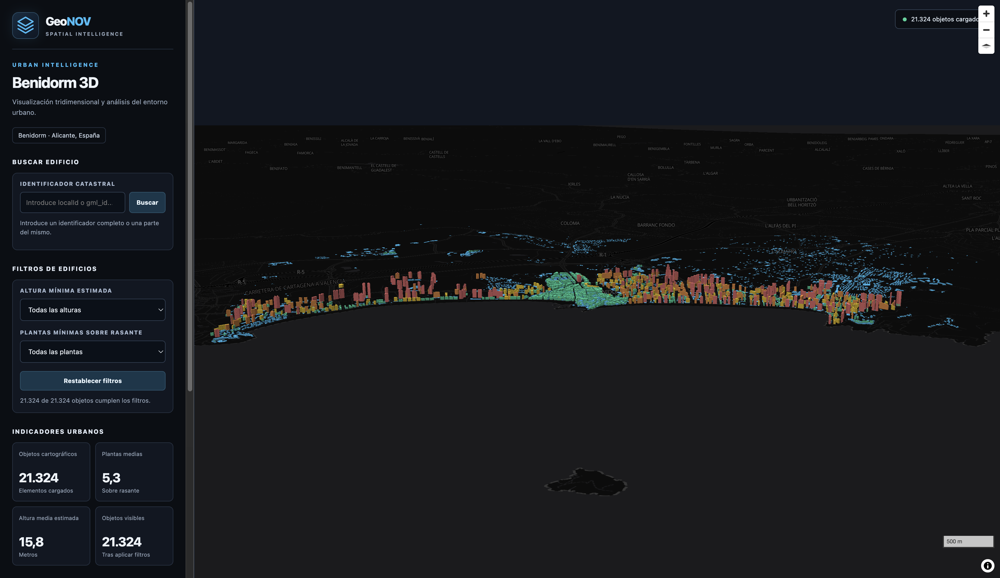
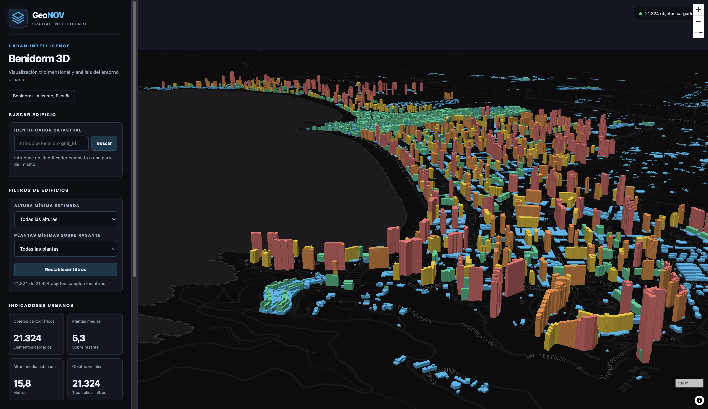
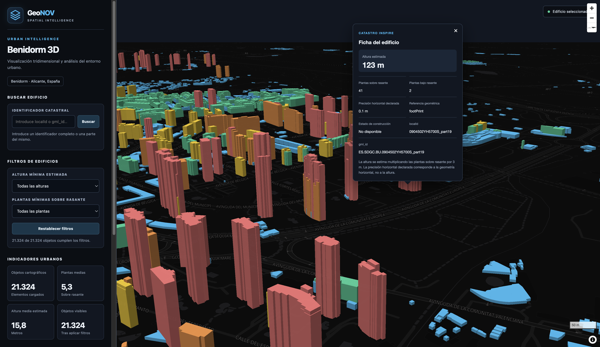

# Benidorm 3D | GeoNOV

**Visor urbano 3D y exploración de datos geoespaciales de Benidorm (Alicante, España).**

Benidorm 3D es un proyecto de exploración geoespacial que combina datos de edificios del Catastro INSPIRE con una aplicación web interactiva. Permite visualizar el entorno urbano en tres dimensiones, consultar atributos y explorar la distribución de las construcciones.

## Vista general



## Funcionalidades

- Visualización interactiva de edificios en 3D.
- Consulta de atributos de los objetos cartográficos.
- Búsqueda por identificadores `localId` y `gml_id`.
- Filtrado por altura estimada y número de plantas sobre rasante.
- Estadísticas descriptivas de los datos.
- Controles para mostrar u ocultar edificios.
- Ventanas emergentes con información disponible de los objetos.

## Exploración tridimensional



El visor permite explorar los edificios y aplicar filtros por altura. La representación tridimensional utiliza una altura estimada a partir del número de plantas registrado.

## Consulta de atributos



La ficha de consulta permite inspeccionar los identificadores y los atributos disponibles del objeto seleccionado.

## Tecnologías

- **MapLibre GL JS:** cartografía web interactiva y representación 3D.
- **GeoJSON:** almacenamiento e intercambio de geometrías y atributos.
- **Python:** preparación e inspección de datos.
- **Shapely:** comprobación de validez topológica.
- **QGIS:** exploración y trabajo con información geográfica.
- **Catastro INSPIRE:** fuente de los datos de edificios utilizados.

## Datos y metodología

El conjunto de datos utilizado contiene 21.324 objetos cartográficos con geometrías `MultiPolygon`.

Los objetos pueden representar edificios completos o partes de edificios; por tanto, el número de registros no equivale necesariamente al número de edificios únicos.

### Estimación de altura

El campo `height_m` se calcula mediante la siguiente regla:

`height_m = numberOfFloorsAboveGround × 3`

Se utiliza una equivalencia de tres metros por planta como aproximación para la visualización tridimensional. **No representa una medición oficial de la altura real de cada edificio.**

Los objetos sin plantas sobre rasante registradas conservan una altura estimada de cero.

### Controles de calidad

Las comprobaciones realizadas hasta el momento han dado los siguientes resultados:

- 21.324 objetos examinados.
- Sin identificadores duplicados detectados en `localId` y `gml_id`.
- Sin valores ausentes en los campos principales examinados.
- Coherencia entre `height_m` y el cálculo de plantas por tres metros.
- 21.324 geometrías de tipo `MultiPolygon`.
- 21.324 geometrías válidas según la comprobación topológica realizada con Shapely.
- Sin geometrías vacías o ausentes detectadas en la auditoría.

Estos controles comprueban determinadas propiedades técnicas, pero no certifican por sí solos la exactitud de todos los atributos, las alturas reales ni la correspondencia administrativa de cada objeto.

## Documentación

- [Metodología del proyecto](docs/metodologia.md)
- [Flujo de trabajo SIG](docs/flujo-trabajo.md)

## Estructura del proyecto

```text
Benidorm-3D/
├── data/
├── docs/
│   ├── capturas/
│   ├── flujo-trabajo.md
│   └── metodologia.md
├── qgis/
├── web/
│   ├── index.html
│   └── benidorm_buildings.geojson
└── README.md
```

## Ejecución local

Se requiere Python 3.

Desde la carpeta raíz del proyecto, ejecuta:

```bash
cd web
python3 -m http.server 8000
```

Abre el visor en el navegador:

http://localhost:8000

Mantén abierta la terminal mientras utilizas la aplicación. Para detener el servidor, pulsa `Control + C`.

## Limitaciones

- Las alturas son estimaciones basadas en el número de plantas.
- Algunos objetos pueden representar partes de edificios.
- La disponibilidad y precisión de los atributos dependen de los datos de origen.
- La validez topológica no garantiza por sí sola la exactitud temática, geométrica o administrativa.
- El visor es un proyecto de exploración geoespacial y no sustituye a los servicios oficiales del Catastro ni a las herramientas técnicas municipales.

## Autoría

Proyecto desarrollado en el ámbito de las tecnologías de información geográfica, la cartografía web y la visualización urbana 3D.

**GeoNOV | Geospatial Intelligence**
